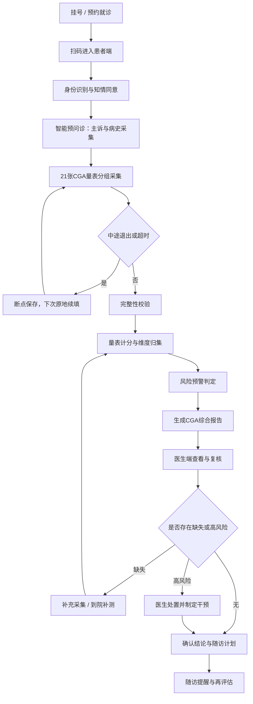
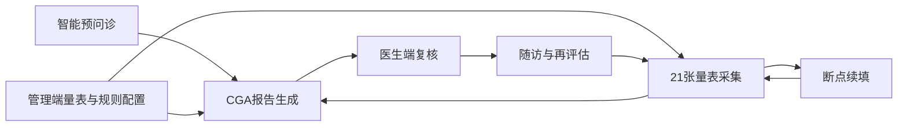

# 老年智能预问诊系统项目构想总需求

> 本文定义系统"做什么、为谁做、按什么流程做、受什么约束"，不展开技术实现细节。量表条目、报告字段等执行层规范见 `docs/01_痛点分析.md` 至 `docs/05_CGA报告框架.md`。

## 一、项目背景与目标用户

### 1.1 项目背景

老年患者普遍存在多重慢性病、感官与认知功能下降、数字素养差异大等特征。传统预问诊依赖纸质表单或面向中青年的通用问诊产品，导致三个结构性缺口：

| 缺口 | 表现 | 后果 |
|---|---|---|
| 操作门槛高 | 触控精度不足、验证码无法完成、层级过深 | 老年患者中途放弃，预问诊数据缺失 |
| 表达与认知不匹配 | 主诉模糊、方言差异、医学术语不理解、病史记不清 | 信息无法结构化，病史失真 |
| 长任务不可持续 | 21 张 CGA 量表题量大、耗时长、采集方式混杂 | 疲劳脱落，报告维度不全 |

老年综合评估（CGA）要求在一次诊前采集中覆盖躯体功能、认知、心理、营养、共病、睡眠、疼痛、排泄、口腔、感官、社会支持等维度。**"老年人"与"多量表长任务"两重难度叠加**，是本系统必须优先解决的核心矛盾。

（上述问题量级可参考示例／公开调研数据，不代表任何特定医院真实统计。）

### 1.2 建设目标

| 编号 | 目标 | 度量方向 |
|---|---|---|
| G1 | 老年患者可独立或在少量协助下完成预问诊 | 完成率提升 |
| G2 | 21 张量表可分段完成、可中断续填 | 完整率提升、缺失可追溯 |
| G3 | 采集结果自动汇总为 CGA 报告 | 报告生成零人工拼凑 |
| G4 | 医生接诊前即可掌握结构化结论与风险 | 诊室内重复问诊减少 |
| G5 | 量表、阈值、报告模板可由管理端配置 | 调整无需开发发版 |

### 1.3 目标用户与角色

| 角色 | 使用端 | 核心诉求 | 关键约束 |
|---|---|---|---|
| 老年患者 | 患者端 | 少操作、能说就不打字、可中断、不被评判 | 大字、语音、断点续填、私密作答 |
| 家属／照护者 | 患者端（代填通道） | 代老人完成、信息标注来源 | 需授权绑定，代填与自填分别标记 |
| 接诊医生 | 医生端 | 一屏看结论与风险、可核验原始作答 | 高风险条目必须医生确认 |
| 系统管理员 | 管理端 | 量表与规则可配、变更可追溯 | 配置生效不发版、全程审计 |

## 二、系统核心业务流程

### 2.1 主流程（从挂号到报告生成）

### 2.2 阶段说明

| 阶段 | 输入 | 系统动作 | 输出 | 失败兜底 |
|---|---|---|---|---|
| 挂号与准入 | 就诊信息 | 极简登录、知情同意 | 会话上下文 | 登录失败 2 次转人工 |
| 智能预问诊 | 语音／文字主诉 | 口语化→结构化、病史带入 | 结构化主诉与病史 | 识别失败切换选项 |
| 量表采集 | 患者／家属／设备 | 分组排序、逐题保存、设备引导 | 21 张量表作答数据 | 设备项标记到院补测 |
| 报告生成 | 作答数据 | 计分→归集→判定→映射 | CGA 报告 | 缺失标注结论不完整 |
| 医生复核 | 报告 | 核验、修改、确认、处置 | 生效结论与干预 | 高风险强制确认 |
| 随访 | 随访计划 | 推送、回填、趋势对比 | 纵向变化记录 | 异常触发再评估 |

**流程关键点**：报告不是流程终点，医生复核才是结论生效的节点；随访使 CGA 从一次性采集变为"评估—干预—随访—再评估"闭环。

## 三、核心功能模块

### 3.1 智能预问诊

| 能力 | 说明 |
|---|---|
| 双通道采集 | 语音与文字并列，语音支持方言／口音容错，失败时降级为标准化选项 |
| 口语化→结构化 | 将"浑身没劲、吃不下饭"映射为症状、部位、时长、程度、诱因字段 |
| 病史带入 | 尝试带入既往病历与用药，向患者核对而非直接采信 |
| 风险初筛 | 主动核对跌倒史、失禁、认知变化、情绪状态 |
| 不确定项处理 | 标记"待医生确认"，不强制追问、不阻断流程 |
| 预问诊小结 | 输出结构化主诉与关键风险，供报告引用 |

### 3.2 21 张 CGA 量表采集

21 张量表按评估维度与采集方式分为 5 个评估组，支持分次完成：

| 评估组 | 主题 | 包含量表 |
|---|---|---|
| A 组 | 躯体功能与活动 | BADL、IADL、SPPB、肌少症筛查（握力／小腿围）、步速测试 |
| B 组 | 认知与心理情绪 | MMSE／Mini-Cog、GDS-15、GAD-7、PHQ-9、认知自评 AD8 |
| C 组 | 营养、衰弱与共病 | MNA-SF、临床衰弱量表 CFS、Morse 跌倒评估、Charlson 共病指数 |
| D 组 | 睡眠、疼痛与排泄 | PSQI、疼痛 NRS、尿失禁（ICIQ-UI SF）、便秘（罗马 IV） |
| E 组 | 口腔、感官与社会支持 | 口腔健康（GOHAI）、视听力、社会支持（SSRS） |

采集方式分四类，由系统按角色分派：

| 采集方式 | 适用量表 | 支持要点 |
|---|---|---|
| 患者自填 | GDS-15、GAD-7、PHQ-9、PSQI、疼痛 NRS、尿失禁、便秘 | 语音优先、隐私作答模式、逐题保存 |
| 家属代填 | BADL、IADL、MNA-SF、认知自评 AD8 | 授权绑定、来源标注、矛盾提示 |
| 设备辅助 | SPPB、肌少症筛查、视听力、步速测试 | 视频示范、操作校验、重复测量 |
| 医生复核 | MMSE／Mini-Cog、CFS、Charlson、Morse、口腔、步速 | 原始作答可见、结论可确认／驳回 |

**排序原则**：高风险、易疲劳维度前置；需设备、需站立项目集中安排；认知与情绪类量表不排在末位，以减轻疲劳效应。

### 3.3 断点续填

| 能力 | 说明 |
|---|---|
| 逐题保存 | 每个作答动作即时落库，异常中断零丢失 |
| 原地恢复 | 退出、超时、更换设备后回到上次题目继续 |
| 已完成清单 | 展示"已完成 X/21"与已完成量表名称 |
| 分段提交 | 允许按评估组完成，不要求一次答完 |
| 完整性校验 | 提交前提示缺失量表及其影响的维度 |
| 到院补测 | 家庭无法完成的设备项标记补测，由医生回填 |

### 3.4 CGA 综合报告生成

报告由 21 张量表数据自动汇总生成，固定包含 8 个板块：

| 板块 | 内容来源 |
|---|---|
| 患者基本信息 | 身份识别＋智能预问诊＋采集完整性 |
| 各量表得分汇总 | 逐表计分与分级结果 |
| 各维度评估结论 | 量表按 12 个维度归集后合成 |
| 综合结论 | 共病叠加＋风险优先聚合 |
| 风险预警 | 阈值命中，分红／橙／黄三级 |
| 干预建议 | 维度→候选建议，医生可编辑确认 |
| 随访计划 | 预警与异常维度→随访项 |
| 医生参考摘要 | 一屏式概览与数据可信度提示 |

**生成链路**：完整性校验 → 逐表计分 → 分级判定 → 维度归集 → 维度结论合成 → 风险预警计算 → 综合结论聚合 → 干预建议映射 → 随访计划生成 → 报告渲染。

**边界**：所有自动结论标注"系统生成，需接诊医生复核"；量表缺失时报告标注"结论不完整"，不得以缺失数据推出确定性结论。

### 3.5 模块协同关系

## 四、非功能性需求

### 4.1 适老化设计

| 要求 | 约束 |
|---|---|
| 字号与触控 | 正文不低于 18pt 等效；触控热区不小于 48×48dp |
| 信息层级 | 核心流程不超过 2 级；任一页面 2 步内可达人工协助 |
| 输入方式 | 语音为第一入口，文字、图示、视频讲解可切换 |
| 文案 | 全部经"老年人可懂度"改写，禁用工程术语 |
| 无障碍 | 兼容系统级大字与屏幕朗读 |

### 4.2 数据安全与合规

| 要求 | 约束 |
|---|---|
| 最小必要 | 仅采集评估必需字段，敏感信息脱敏展示 |
| 分级授权 | 患者、家属、医生、管理员数据可见范围分离 |
| 传输与存储 | 加密传输；身份证等敏感字段加密存储，接口不返明文 |
| 知情同意 | 首次使用前置告知数据用途与呈现范围 |
| 审计留痕 | 配置变更、数据访问、医生修改全程可追溯 |
| 责任边界 | 系统不提供诊断与处方；高风险条目必须医生确认 |

### 4.3 性能与可靠性

| 要求 | 约束 |
|---|---|
| 响应时间 | 常规接口 ≤ 2 秒；超时（≤ 5 秒）触发降级提示，不丢已答内容 |
| 数据不丢失 | 逐题实时保存；异常中断后恢复率 100% |
| 弱网支持 | 支持离线暂存与恢复同步 |
| 多端兼容 | Android／iOS、小程序／公众号、平板与自助终端 |

### 4.4 可配置与可扩展

| 要求 | 约束 |
|---|---|
| 量表配置 | 新增、停用、排序、分组、版本管理均无需发版 |
| 规则配置 | 计分规则、分级界值、风险阈值可视化配置 |
| 报告模板 | 板块顺序、维度归集、结论映射可配置 |
| 配置治理 | 变更灰度生效、可回滚、留痕审计 |

---

**文档定位说明**：本文为项目级构想，回答"为什么做、给谁做、做什么、受什么约束"。执行层细节见：

| 文档 | 作用 |
|---|---|
| `docs/01_痛点分析.md` | 五类痛点的四段式论证 |
| `docs/02_需求分析.md` | 角色、功能与非功能需求编号 |
| `docs/03_功能规划.md` | 三端功能树与关键流程 |
| `docs/04_21张量表清单.md` | 21 张量表的计分、采集方式与耗时 |
| `docs/05_CGA报告框架.md` | 报告板块与自动汇总机制 |
| `AGENT.md` | AI 智能体行为规范与输出格式 |
